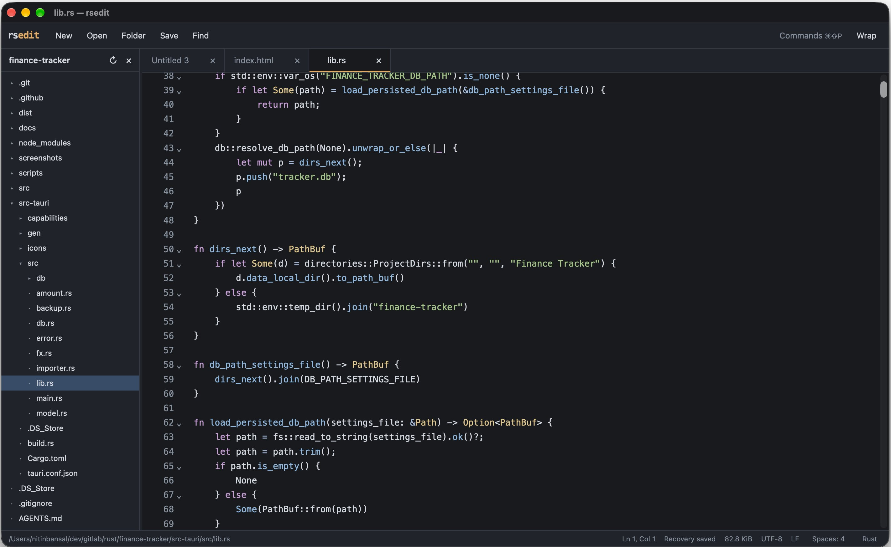

# rsedit

A super-fast, focused text editor in the spirit of Sublime Text, built with a Rust
file engine, Tauri, and CodeMirror. No accounts, extensions, language servers,
telemetry, or background indexing.

rsedit is part of the GoodApps collection of free,
open-source desktop apps.

[Downloads](https://github.com/goodappsstore/rsedit/releases) ·
[Source](https://github.com/goodappsstore/rsedit) ·
[Issues](https://github.com/goodappsstore/rsedit/issues)

## Screenshots

### rsedit homescreen



## Install

Download an installer from [GitHub Releases](https://github.com/goodappsstore/rsedit/releases)
for your operating system and processor. If no release is available yet, build
from source below.

| Platform | Architectures | Packages |
| --- | --- | --- |
| macOS | Apple silicon, Intel | DMG |
| Windows | ARM64, x64 | EXE, MSI |
| Linux | ARM64, x64 | AppImage, DEB, RPM |

On macOS, drag rsedit into Applications. On Linux, allow execution before opening
an AppImage. macOS builds are ad-hoc signed and not notarized; Windows installers
are unsigned, so your system may request approval on first launch.

The app has been built locally on macOS Apple silicon. Windows/Linux builds and
native interactions have not yet been verified; the release workflow targets
all platforms listed above.

## Features

- Intentionally limited set of features focusing on being a text editor, not IDE.
- Fast text/code editing with lazy syntax highlighting.
- Bounded multi-GB opening; a 3 GiB release UI probe opened within two seconds
  on the measured Mac (see the performance limits below).
- Tabs, recent files, drag-and-drop opening, and a resizable folder panel.
- Split editor panes side by side, with a draggable divider and session restore.
- Multiple cursors, rectangular selection, indentation, and comment shortcuts.
- Find/replace with regex, case and whole-word options, and match counts.
- Syntax highlighting for Rust, JavaScript, TypeScript, Python, JSON, Markdown,
  SQL, shell, and more. Language parsers load on demand.
- Command palette, fuzzy quick-open within the selected folder, light/dark
  themes, word wrap, and adjustable font size.
- Per-file indentation detection, literal tabs or 2/4/8 spaces, and explicit
  whole-file indentation conversion.
- Focus-time checks for external file changes, with clean-buffer reload and
  recovery choices for edited buffers.
- Periodic crash recovery and session restore for open tabs and unsaved buffers,
  plus up to 50 closed tabs.

Open files through the dialog, drag them into the window, or pass paths to the
executable. macOS Open With is supported. Use **File → Open Folder…** to browse
a folder; entries load on expansion and refresh manually. **Mod+P** fuzzy-matches
open tabs and relative paths beneath that folder. Folder search runs only when
requested, with no persistent index. Each request returns at most 80 results
and stops after 50,000 entries or one second; the palette reports partial results
and unreadable directories. It skips `.git`, `node_modules`, `target`, and directory
symlinks. Without a selected folder, quick-open searches open tabs.

Right-click (or `Shift+F10` on a focused row) a folder entry to create files
and folders, rename, permanently delete with confirmation, copy the path, or
reveal it in the system file manager. Open buffers track renames; deleting a
file closes its clean tabs but keeps edited buffers, which offer Save As to
survive.

**Mod+\\** (or View → Split Editor Right) shows a second file beside the
current one. Click either side to focus it; the toolbar, search panels, page
navigation, and status bar follow focus. The tab strip is shared: clicking a
tab shows it in the focused pane, and closing a pane never closes its file.
The split restores with the session; the divider width is remembered.

Click the indentation indicator to choose spaces or literal tabs for the current
file, or to convert its leading indentation. Detection samples the first 64 KiB;
ambiguous or mixed indentation may need an explicit choice. Changing the setting
affects future input; conversion is a separate undoable command and preserves
alignment using the selected tab width. The setting is retained in the session.

## Keyboard shortcuts

`Mod` means `Cmd` on macOS and `Ctrl` on Windows/Linux.

| Action | Shortcut |
| --- | --- |
| New / Open / Save | Mod+N / Mod+O / Mod+S |
| Open folder | Mod+Alt+O |
| Save As | Mod+Shift+S |
| Close / Reopen tab | Mod+W / Mod+Shift+T |
| Find | Mod+F |
| Command palette | Mod+Shift+P |
| Quick-open folder files / open tabs | Mod+P |
| Split editor right / close split | Mod+\ |
| Next / Previous tab | Ctrl+Tab / Ctrl+Shift+Tab |
| Undo / Redo | Mod+Z / Mod+Shift+Z |
| Select next occurrence | Mod+D |
| Select all occurrences (visible view for huge files) | Mod+Shift+L |
| Duplicate line up / down | Alt+Shift+Up / Alt+Shift+Down |
| Move line up / down | Alt+Up / Alt+Down |
| Delete line | Mod+Shift+K |
| Find/replace in visible view only (huge files) | Mod+H |
| Add cursor above / below | Mod+Alt+Up / Mod+Alt+Down |
| Go to line | Mod+G |
| Toggle comment | Mod+/ |
| Toggle wrap | Mod+Shift+W |
| Font size / Reset | Mod+plus / Mod+minus / Mod+0 |

## Large files and performance

Opening a multi-GB file reads only a sample and its first **256 KiB** view.
Unchanged content remains on disk, and reads, search, saves, and recovery copies
run on workers. Opening does not scan the whole file or create a recovery copy.

Files up to **64 MiB** normally use the full editor: continuous scrolling,
whole-document regex find/replace, selections, and CodeMirror undo. A physical
line longer than **1 MiB** also selects bounded views. Files above 4 MiB start with
plain text to avoid automatic parser work; a language can still be selected
explicitly.

For huge files, bounded views are for navigation; edits belong to one disk-backed
document. Saving always streams the **entire resulting file**, with unchanged
bytes retained exactly. The toolbar moves between views or jumps to a byte offset.

- **Mod+F** always opens case-sensitive literal **whole-file find/replace**.
  Replace all streams into a temporary disk buffer, shows progress, and commits
  only after the operation succeeds and source guards pass. Your user file changes
  only when you Save. Replacement and indentation conversion are undoable.
- **Undo/redo span views and saves**. Pending view edits become a history group
  when flushed for navigation, recovery, save, whole-file operations, or undo.
  Ordinary files retain CodeMirror's typing history. Restart starts fresh history.
- Line numbers, go to line, selections, and multiple cursors remain relative to
  the **visible view**. **Mod+H** explicitly opens view-only regex find/replace;
  its scope is displayed, including the scope of Replace all. Whole-file regex
  replacement and continuous scrolling across huge-file views are not supported.
- Extremely long lines use plain text. Views may lack preceding multiline syntax
  context; folding and bracket assistance are omitted in bounded mode.
- Unchanged text survives local edits byte-for-byte, including BOM, UTF-8, CRLF,
  and mixed separators outside changed ranges. Memory grows with edits, loaded
  views, and undo history. Whole-file operations require temporary disk space.
- Long operations display status/progress and lock the affected document while
  allowing tab switching. A background recovery copy captures immutable pieces
  with a brief document lock; its disk streaming does not lock out typing.

Release measurements on an M1 Air with 8 GiB RAM, macOS arm64, using disposable
3 GiB text fixtures on the local filesystem:

| Measurement | Result |
| --- | --- |
| First 3 GiB native view readiness, from Rust entry | 1.34 s |
| 3 GiB native open request to view readiness | 132 ms |
| 3 GiB Rust-core open and first-view read | 0.46–1.23 ms |
| Peak RSS, separate Rust-core open-only process | 2.3 MiB |
| Sampled native app RSS at initial view | About 98 MiB |
| Sampled newly spawned WebKit processes, combined RSS | About 95 MiB |
| First full recovery source copy for an edited 3 GiB file | 3.52–5.53 s |
| Subsequent checkpoint after another one-byte edit | 9.4–13.2 ms |
| Unchanged / edited checkpoint after recovery restart | 5.3–9.9 / 9.1–9.5 ms |
| Recovered 3 GiB Save As | 4.50–4.75 s |

Native readiness includes webview initialization and two animation-frame callbacks
after installing the first view; it excludes process-loader time and is not a
first-paint instrument. Native RSS is a point-in-time sample, not a peak, and the
WebKit total covers newly spawned content/GPU/networking processes. Core timings
exclude the native UI. Fixtures were freshly written or warm; cold storage,
remote filesystems, and Windows/Linux UI performance are not established. The
under-two-second target is demonstrated on this setup, not a guarantee for every
machine or storage device. Set `RSEDIT_PROFILE_STARTUP=1` on a release executable
to log editor and newly opened view readiness.

## Sessions and file safety

Quitting preserves open tabs and unsaved buffers without prompts. Individual
unsaved tab closes still ask. Tabs restore lazily, retaining position and language
choice; undo history starts fresh after restart.

Session copies are separate from your files. Use **Save** or **Save As** to
write edits to disk. Recovery data lives in the app data directory's `session/`
folder; on macOS this is normally
`~/Library/Application Support/com.goodapps.rsedit/session/`.

Recovery is checkpointed **every 30 seconds** after startup, as well as on orderly
quit. A busy file can defer a periodic checkpoint; the next interval retries.
The status bar shows checkpoint progress, success, failure, and newer edits still
awaiting recovery. Crashes and force
quit restore the last completed checkpoint; newer edits can still be lost.

For edited huge files, the first checkpoint streams an immutable copy of each
source into the session directory. Later checkpoints reuse those copies and
store changed bytes plus piece references, including after recovery restart.
Unchanged buffers reuse their last snapshot. The manifest is replaced only after
all new recovery data is synced; an interrupted checkpoint leaves the previous
manifest usable. A corrupt/unreadable manifest and failed recovery buffers are
preserved. The window stays open if its final checkpoint fails. Recovery copies
can take seconds and require disk space, especially after a whole-file operation.

rsedit supports UTF-8 text, including a BOM and LF/CRLF. Binary and UTF-16 files
are rejected; huge files are validated view by view. New editor line breaks use
the detected separator; unchanged source bytes keep their original separators.

Saves guard against external changes using size and modification time, preserve
basic permissions, and replace the destination through a synced temporary file.
Retained disk handles also carry their own metadata guards, so undo cannot
silently read changed old source bytes after Save As. These checks can miss changes
that preserve metadata. On regaining focus, rsedit checks open files, reloads clean buffers, and offers edited buffers choices
to keep edits, Save As, copy the visible text to a new recovery tab, or reload
with a discard prompt. Repeated notices for the same disk version are suppressed.
There is no live watcher or power-loss recovery guarantee. Symlinks resolve to
their target; hard links, extended metadata, and ACLs may not survive replacement.

If an original disk-backed huge-file source changes externally, rsedit cannot
safely reconstruct unseen old bytes. Use **Copy visible text to a new recovery
tab** before reloading, and retain the last successful checkpoint. Fully loaded,
restored, or completely transformed buffers can be rescued with **Save As** to
another path. rsedit never silently overwrites an external change.

## Build from source

Install Node.js 24, current stable Rust, and the
[Tauri platform prerequisites](https://v2.tauri.app/start/prerequisites/).
Use the committed lockfiles.

```sh
git clone https://github.com/goodappsstore/rsedit.git
cd rsedit
npm ci
npm run tauri dev
```

Build native installers:

```sh
npm run tauri build -- -- --locked
```

On macOS, build only the application bundle:

```sh
npm run tauri build -- --bundles app -- --locked
```

The macOS application is written to
`src-tauri/target/release/bundle/macos/rsedit.app`.
`npm run dev` provides a browser preview with a scratch buffer; filesystem access
and saving require the desktop app.

## Contributing

Report bugs or suggest focused improvements through
[GitHub Issues](https://github.com/goodappsstore/rsedit/issues). Include your OS,
app version, steps to reproduce, and any relevant error message.

For code changes, read [AGENTS.md](AGENTS.md), keep the editor small, and run:

```sh
npm run check
cargo fmt --manifest-path src-tauri/Cargo.toml -- --check
cargo clippy --locked --manifest-path src-tauri/Cargo.toml --all-targets -- -D warnings
node .github/scripts/check-release.mjs
```

The frontend is strict TypeScript with vanilla DOM and CodeMirror in `src/`.
Rust file handling, sessions, and native commands live in `src-tauri/src/`.

Verification for these changes used disposable Rust fixtures for byte preservation,
BOM/UTF-8/CRLF boundaries, permission preservation, external-save guards, stale
revisions, cross-view/cross-save undo, streamed replacement and indentation,
3 GiB recovery copies, restart snapshot reuse, unreadable manifests, and folder
quick-open. Disposable DOM probes covered per-file indentation, conversion/undo,
fuzzy tab filtering, and palette discoverability. Mocked desktop IPC probes
covered typing during recovery streaming, checkpoint/close/reopen ordering,
focus-time clean reload and edited-buffer recovery choices, and quit preserving
open/closed buffers without unsaved prompts. The macOS release app was
launched with an isolated application identifier and a disposable 3 GiB file;
opening/readiness and memory were measured without screenshots. Native dialogs,
focus interactions, and Windows/Linux runtime behavior remain unverified.

## Releases

[CI](.github/workflows/ci.yml) checks tag pushes on macOS, Windows, and Linux.
Branch pushes, pull requests, and manual dispatches do not trigger workflows.
The [release workflow](.github/workflows/release.yml) runs only on `v*` tag pushes,
builds six native targets, and publishes after verifying all twelve installers. Failures
leave a draft; published installers require a new version to replace.

Before pushing a `vMAJOR.MINOR.PATCH` tag, align the version in `package.json`,
`package-lock.json` (both root entries), `src-tauri/tauri.conf.json`,
`src-tauri/Cargo.toml`, and the rsedit entry in `src-tauri/Cargo.lock`.

```sh
node .github/scripts/check-release.mjs v0.1.0
```

The [release validator](.github/scripts/check-release.mjs) defines installer
names. Installers stay on GitHub Releases.
GitHub-hosted releases have not yet been verified.

## License

MIT — see [LICENSE](LICENSE).
